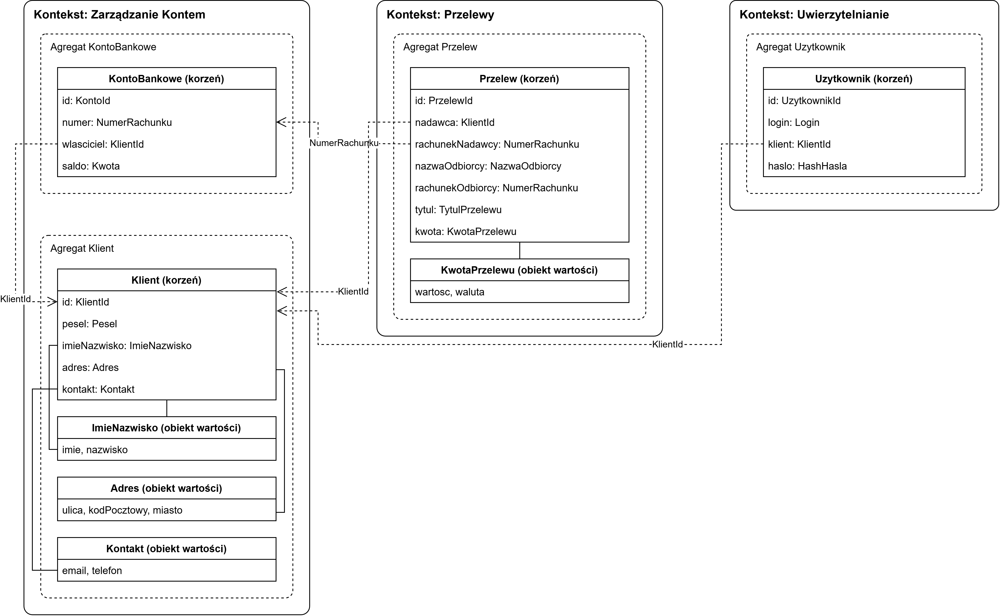

## Opis zadania

Zadanie polegało na zamodelowaniu fragmentu bezpiecznej aplikacji bankowej wykorzystując zasady Domain Driven Design. W modelu zdefiniowano trzy konteksty ograniczone (Zarządzanie Kontem, Przelewy, Uwierzytelnianie), agregaty (KontoBankowe i Przelew), encje (Klient, Adres, KwotaPrzelewu) i obiekty wartości (ImieNazwisko, Adres, Kontakt, KwotaPrzelewu). Reguły biznesowe ujęte jako założenia modelu uniemożliwiają utworzenie niepoprawnego obiektu.

## Model

## Założenia

